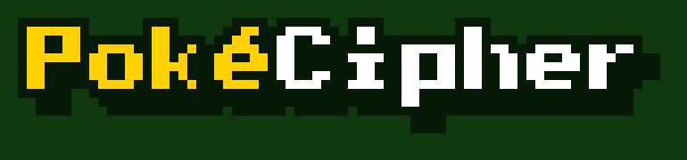
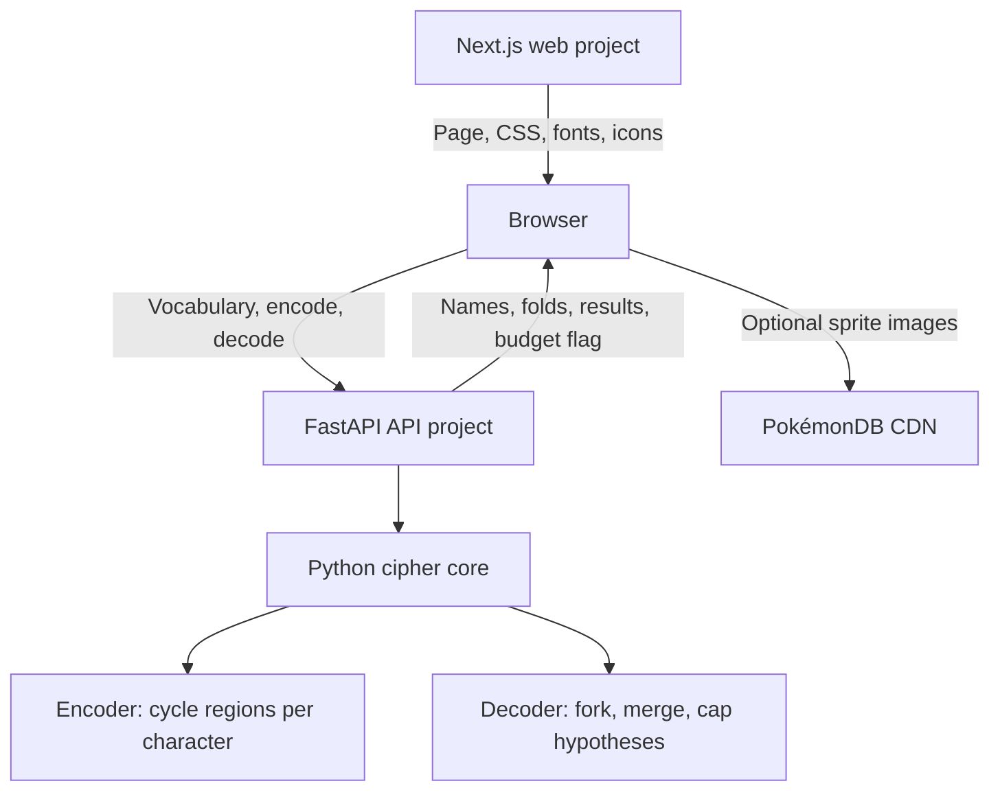

<p align="center">
  
</p>

<p align="center">
  <a href="https://github.com/pterw/PokeCipher/actions/workflows/ci.yml"></a>
  <a href="https://poke-cipher.vercel.app"></a>
  
  <a href="https://docs.astral.sh/ruff/"></a>
</p>

A retro, Pokédex-themed web app that encodes text as Pokémon names and decodes
those names back into text. The same Pokémon can represent different characters
in different regions, so a message can have more than one valid reading.

Built with Next.js and Python, deployed on Vercel.

## What the cipher does

PokéCipher is a **stateful polyalphabetic substitution cipher**. It maps
printable ASCII characters (codes 32–126) onto regional Pokédex entries:

1. Normalise a character to an index: `index = ord(char) - 32`.
2. Look up how many times that character has already appeared.
3. Pick the region using `previous_count % 3`. The first occurrence starts in
   Kanto, then repeats cycle through Johto, Hoenn, and back to Kanto.
4. Emit the Pokémon at `index` in that region's list; increment the count.

Characters outside printable ASCII use literal tokens such as `[NEWLINE]` or
`[CHAR:128512]`. Pokémon names can appear in more than one regional dex, which
is what gives the decoder multiple possible readings.

### Example

`Hello` encodes to:

```
Zubat Weepinbell Ponyta Gyarados Slowbro
```

Note the two `l`s become `Ponyta` then `Gyarados`: the second `l` has cycled to
the Johto list.

### Decoder output

| Notation | Meaning |
|---|---|
| `x` | The surviving hypotheses agree on this character. |
| `[x,y]` | **Ambiguity** — several characters remain valid at this position. |
| `{x,y}` | **State mismatch** — no valid interpretation; the ciphertext is likely corrupted. |
| `<?unknown: X>` | `X` is not a known Pokémon name. |
| `<?>` | An invalid `[CHAR:N]` token. |

`Hello World!` round-trips to `Hello W[n,o]rld!`: `Slowpoke` maps to both `n`
(Kanto) and `o` (Johto), and nothing later in the message disambiguates it.

Decoding forks one hypothesis per candidate character and merges hypotheses that
reconverge, so a later Pokémon often resolves an earlier ambiguity after the
fact — `Nidoking Geodude Shroomish Nidoking` decodes cleanly to `AAAA`.
`Nidoking Geodude` on its own is ambiguous (`A[A,i]`), because `Geodude` means
`i` to Kanto and a second `A` to Johto, and both are legal there. The following
`Shroomish` is only an `A`, in Hoenn, so it kills the `i` branch and resolves the
earlier position.

## Architecture



| Code | Responsibility |
|---|---|
| [`next-app/`](next-app/) | Next.js 16, React 19, Tailwind v4, and shadcn/ui with 8bit components. The hero explains the cipher and the form runs it. |
| [`app.py`](app.py) | Validates HTTP input, runs the synchronous cipher in a threadpool, and returns JSON. |
| [`pokecipher/`](pokecipher/) | Owns the regional dexes, name normalization, and encode/decode logic. |
| [`cipher.py`](cipher.py) | Keeps the historical Python import path working. |

The page fetches the vocabulary and punctuation substitutions together, so
Python owns the rules used by the decode gate. Decode results use markers for
individual positions and a separate flag when the search budget discarded
hypotheses. Keeping that flag outside the plaintext preserves the result
format for existing consumers.

### Frontend assets

| Asset | Design and delivery |
|---|---|
| [Display fonts](next-app/app/fonts/README.md) | Press Start 2P is used for the wordmark and headings. VT323 is used for the terminal, controls, and results. Both Latin WOFF2 files ship with their SIL Open Font License files and load via `next/font/local`, so the build and browser load them without contacting a font provider. |
| [Pokémon sprites](next-app/components/pokemon-token.tsx) | PokémonDB serves the Generation 3 Ruby/Sapphire set at runtime. The set covers all three regional rosters and matches the pixel-art UI. The 64×64 sprites render at 32×32. Failed image loads fall back to names, and the user can switch to names at any time. |
| [Palette](next-app/app/globals.css) | A single Game Boy green palette gives the UI its identity. Separate accent colours distinguish ambiguity, state mismatches, and unknown tokens. |
| [Wordmark and favicons](#branding-assets) | The README wordmark and browser icons are committed generator outputs. The deployed header wordmark is styled text using Press Start 2P. |

## Running it locally

Python side, from the repository root:

```bash
python -m pip install -e ".[dev]"
python -m pytest              # run the test suite
python -m ruff check .        # lint
uvicorn app:app --port 8000   # serve the API for the frontend
```

The frontend proxies `/api/*` to port 8000 in local development, so run that
alongside `npm run dev`. It is the same `app.py` that runs in production.

Frontend, from `next-app/` with Node.js 24:

```bash
npm ci
npm run dev               # http://localhost:3000
```

Run `npm ci` before starting the dev server, not while it is running: it replaces
`node_modules`, and a dev server that loses it mid-flight dies with a confusing
workspace-root error. `npm run build` and `rm -rf .next` are the same hazard,
because both rewrite the `.next` directory the dev server is using.

If you reach the dev server through a proxy or a hosted workspace rather than
`localhost`, add that host to `allowedDevOrigins` in `next.config.ts`. Without it
Next serves the HTML with 200 and then refuses every `/_next/static/*` request
with 403, so the page loads unstyled and inert, which looks like a broken build
rather than a rejected origin.

## Continuous integration

The [CI workflow](.github/workflows/ci.yml) runs lint and type checks first,
then Pytest on Python 3.10 and 3.12 and Vitest on Node 24. Once those pass,
it builds Next.js and checks smart punctuation and branch-budget reporting
through the running web server and FastAPI. With both local servers running,
run the same smoke test from the repository root.

```bash
python scripts/smoke_http.py http://localhost:3000
```

`Quality Gate` is the single check to require for merges into `main`. It
fails if a prerequisite fails, is cancelled, or is skipped. [Dependabot](.github/dependabot.yml)
opens monthly update PRs for Python, npm, and GitHub Actions.

## Deployment

The repository deploys as two Vercel projects, each with its own framework preset.

| Project | Root directory | Framework | Serves |
|---|---|---|---|
| API | `.` (repository root) | `fastapi` | [`poke-cipher-api.vercel.app`](https://poke-cipher-api.vercel.app), Python 3.12 |
| Web | `next-app` | `nextjs` | [`poke-cipher.vercel.app`](https://poke-cipher.vercel.app), Node.js 24 |

The old file-based `api/*.py` handlers failed at function discovery on the new
Vercel project. The FastAPI preset imports the top-level `app` in `app.py` and
ships its routes as one Function. The root [`vercel.json`](vercel.json) sets the
function timeout and excludes frontend files from the Python bundle.
[`.python-version`](.python-version) selects Python 3.12 and
[`pyproject.toml`](pyproject.toml) supplies dependencies. The web project pins
`nextjs` in [its own `vercel.json`](next-app/vercel.json), which prevents it from
inheriting the root FastAPI preset.

For local development, leave `NEXT_PUBLIC_API_URL` empty. The browser calls
`/api/*` on the Next.js origin, and Next forwards it to Uvicorn on port 8000.
On Vercel, the frontend gets the API origin from `NEXT_PUBLIC_API_URL` at build
time and the browser makes cross-origin requests directly. FastAPI handles CORS.

Both projects deploy from `main` and build previews per pull request. For a PR
that changes the web/API contract, set a branch-scoped Preview value of
`NEXT_PUBLIC_API_URL` on the web project to the matching API branch URL before
building the web preview. Verify both deployments are on the same commit before
testing the pair. The production domains follow their respective projects'
production deployments.

## API

`POST /api/encode` and `POST /api/decode` both take `{"text": "..."}` and return
`{"result": "..."}`. The API validates the body directly to preserve its
`{"error": "..."}` shape with status 400 or 413. It checks a 32 KiB JSON body
limit and a 4,000-code-point text limit separately.

```bash
curl -X POST https://poke-cipher-api.vercel.app/api/encode -d '{"text":"Hello"}'
# {"result":"Zubat Weepinbell Ponyta Gyarados Slowbro"}
```

Decoding ignores case, so ciphertext that has been through a URL or a chat client
still works:

```bash
curl -X POST https://poke-cipher-api.vercel.app/api/decode   -d '{"text":"zubat weepinbell ponyta gyarados slowbro"}'
# {"result":"Hello"}
```

A decode that exceeded the search budget returns its best-effort result with
`"truncated": true`. This example uses the local API running on port 8000.

```bash
python - <<'PY' | curl -sS http://localhost:8000/api/decode \
  -H 'Content-Type: application/json' --data-binary @-
import json
from pokecipher import encode_message

print(json.dumps({"text": encode_message("hello world this is a test of the cipher")}))
PY
# {"result":"hello wnrld this ]s [a,h] test {o}[a,f] t[a,h]e cbphe[J,r]","truncated":true}
```

`truncated` is absent from every response that fits inside the budget, so the
documented shape is unchanged for ordinary messages. The app shows it as a
warning under the result.

`GET /api/names` returns 210 sorted canonical names and the `folds` map of
accepted punctuation substitutions. The browser uses the payload to check
whether the first token looks like ciphertext. The response is cacheable for
an hour.

## Known limitations

- **Long messages can decode to text the cipher could not have produced, and the
  decoder says so.** Decoding keeps every hypothesis that is still consistent,
  which for prose is exponential: 500 characters of ordinary English sustain
  about 5,200 distinct hypotheses. `MAX_DECODE_BRANCHES` caps that at 32, and the
  dropped branches can include the true reading, so a long decode can report a
  character no valid reading supports. Measured: 75 of 300 random sentences do,
  first at about 30 characters; `hello world this is a test of the cipher`
  decodes to `hello wnrld this ]s ...`. Raising the cap does not fix it (prose
  still lies at 1,024 branches, at 5 s per 1,000 characters), so the API reports
  `truncated` so the caller knows hypotheses were dropped. An unflagged decode
  can still contain ambiguity or mismatch markers. The cap's numbers and the
  reasoning behind them live in `test_cipher_invariants.py`.
- **Decode time depends on how much ambiguity survives.** The decoder emits each
  position as soon as it is final, so ordinary text stays close to linear —
  measured on CPython 3.13, ~1.2 s for 10,000 characters of prose at the shipped
  branch budget. Text that sustains an unresolved ambiguity throughout cannot
  collapse and degrades to quadratic (~3.3 s at 4,100 characters). The API caps
  input at 4,000 characters so even that worst case fits inside the function
  timeout.
- **The cipher is not cryptographically secure.** It is a puzzle and a teaching
  tool for substitution ciphers and state tracking, not a way to protect data.
- Only the first 95 entries of each regional dex are used. Names containing
  spaces (Mr. Mime, Tapu Koko) cannot be added without changing the delimiter,
  and changing the delimiter would invalidate every message ever encoded.

## Branding assets

The wordmark and the favicon are generated rather than hand-drawn, so they stay
in step with the palette instead of drifting from it:

```bash
python docs/make_wordmark.py                # writes docs/wordmark.svg
python docs/make_favicon.py                 # rewrites favicon.ico from icon.svg
python docs/make_favicon.py <sprite.png>    # rewrites icon.svg and favicon.ico
```

Both outputs are committed, so neither GitHub nor the deployment ever needs to
run these scripts.

- **`docs/wordmark.svg`** draws every letter from explicit pixel rectangles.
  GitHub cannot load webfonts inside a README image, so text set with `<text>`
  would fall back to whatever the viewer happens to have installed and stop
  looking like the app.
- **`docs/make_favicon.py`** writes two files, because Next.js publishes every
  icon it finds in `app/` and browsers choose between them inconsistently.
  `icon.svg` is vector and follows `prefers-color-scheme`; `favicon.ico` is a
  raster and cannot, so it carries its own field instead — a dark disc that reads
  on a light toolbar, ringed in a light colour that reads on a dark one. The ICO
  is rasterised from the committed SVG rather than by rendering the sprite a
  second time, so the two cannot drift apart, and a fresh checkout can rebuild it
  without needing the sprite at all.
- **The ICO's field and the sprite's ink never share a shade.** The sprite's
  darkest pixels are its outline, ear tips and eye pupils; snapping those onto
  the disc's own colour painted Pikachu's contour in the background colour and
  left the tab icon unreadable. The sprite draws with the three lighter Game Boy
  shades and the field keeps the darkest, which is what makes the outline legible.
- **The raster averages the art instead of sampling it.** At 16px one output
  pixel spans about 2.3 sprite pixels, so reading a single pixel per output pixel
  discards more than half the art in each axis — the eyes and the nose go first.
  Each output pixel is averaged over the whole footprint it covers instead.

Neither format follows the page's colour scheme: a favicon is drawn in browser
chrome, outside the document, so it cannot see the app's palette at all. The SVG
at least gets `prefers-color-scheme`; the ICO gets nothing, which is why it
carries a fixed dark field and a light ring. The app itself has one palette and
no theme switch, by design — the greens are the identity, not a mode. The art is the
Generation 1 Pikachu sprite from Pokémon Yellow, the era the Game Boy palette
comes from. Sprite art is the property of Nintendo / Game Freak / Creatures Inc.,
and the source sprite is deliberately not committed: `favicon.ico` is rebuilt from
`icon.svg`, so the sprite is only needed to change the art itself.

## TODO

[ ] Organize root repo (folders, etc.) 
[ ] Rework mobile UI (tweaks or redesign) 
[ ] Adresss prior review feedback 
[x] Replace screenshot
[x] Include README.MD badges 
[ ] Include social badges on webapp 

More to come. 

## Project conventions

See [AGENTS.md](AGENTS.md) for the architecture rules, testing expectations, and
deployment details that contributors and AI agents should follow.

## License

The source code in this repository is released under the [MIT License](LICENSE).

Pokémon, the Pokémon names, and the sprite artwork are trademarks and
copyrighted works of Nintendo, Game Freak, and Creatures Inc. They appear here
descriptively, as the cipher's alphabet: this project is not affiliated with,
endorsed by, or licensed by them, and the MIT license does not extend to those
names or to any sprite art. The wordmark and favicon generators ship without the
source sprite for the same reason.
